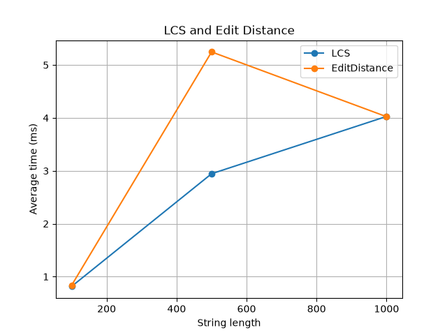
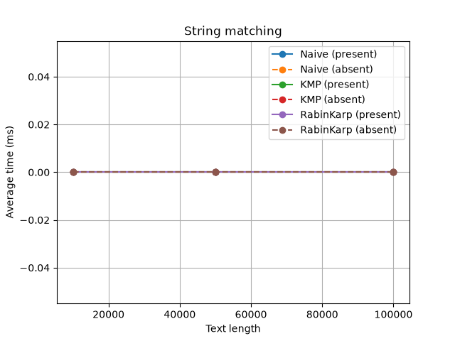
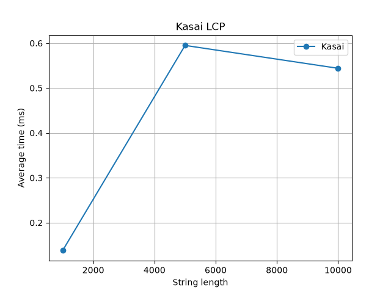

# Assignment 4 — Text Analysis: Dynamic Programming and String Algorithms

## 1. Problem description and algorithm overview

In this assignment I implemented algorithms for text analysis in Java: two dynamic programming algorithms, three string matching algorithms and Kasai's algorithm for LCP array. Then I analyzed their complexity and measured running time to compare theory with practice.

Implemented algorithms:

**Part A — Dynamic Programming**
- **LCS (Longest Common Subsequence)** — finds the length of the longest subsequence that is common for two strings.
- **Edit Distance (Levenshtein)** — finds minimum number of insertions, deletions and substitutions to transform one string into another.

**Part B — String Matching**
- **Naive** — checks the pattern at every position of the text. Used as baseline.
- **KMP (Knuth–Morris–Pratt)** — preprocesses the pattern into LPS table and never moves back in the text.
- **Rabin–Karp** — compares hash of the pattern with rolling hash of each text window.

**Part C — Advanced**
- **Kasai's algorithm** — builds LCP array from a string and its suffix array.

### Project structure

```
src/
  dp/          LCS.java, EditDistance.java
  matching/    NaiveMatcher.java, KMPMatcher.java, RabinKarpMatcher.java
  suffix/      Kasai.java
  Tests.java       tests for all algorithms
  Benchmark.java   experiments
results/results.csv  experiment results
plots/               plots (generated by plot.py)
plot.py              script for plots
```

### How to compile and run

Requirements: Java 17+ (I used IntelliJ IDEA), Python 3 with matplotlib for plots.

In IntelliJ: open the project and run `Tests` or `Benchmark` with the green run button.

From command line (in project root):

```
javac -d out src/dp/*.java src/matching/*.java src/suffix/*.java src/Tests.java src/Benchmark.java
java -cp out Tests
java -cp out Benchmark
python plot.py
```

`Benchmark` writes results to `results/results.csv`, then `plot.py` reads this file and saves plots into `plots/`.

## 2. Implementation decisions and assumptions

**LCS and Edit Distance**

Both use a full DP table of size `(n+1) x (m+1)`.

LCS: `dp[i][j]` = LCS length of first `i` chars of `a` and first `j` chars of `b`.
- Base case: `dp[0][j] = dp[i][0] = 0`
- If `a[i-1] == b[j-1]`: `dp[i][j] = dp[i-1][j-1] + 1`
- Else: `dp[i][j] = max(dp[i-1][j], dp[i][j-1])`

Why it is correct: if the last characters are equal, they can always be part of the LCS, so we take them and solve the smaller problem. If they are not equal, at least one of them is not in the LCS, so we try to remove each one and take the better result.

Edit Distance: `dp[i][j]` = minimum operations to transform first `i` chars of `a` into first `j` chars of `b`.
- Base case: `dp[i][0] = i` (delete all), `dp[0][j] = j` (insert all)
- If `a[i-1] == b[j-1]`: `dp[i][j] = dp[i-1][j-1]`
- Else: `dp[i][j] = 1 + min(dp[i-1][j] (delete), dp[i][j-1] (insert), dp[i-1][j-1] (substitute))`

Why it is correct: the last character of `a` must be either deleted, matched/substituted with last char of `b`, or `b`'s last char is inserted. We check all three cases and take the minimum, so the answer is optimal.

**String matching**

- All three methods return `List<Integer>` with all starting indices (overlapping matches are included, e.g. `"aba"` in `"abababab"` gives `[0, 2, 4]`).
- **Empty pattern:** returns empty list. I decided that searching empty pattern does not make sense, so there are no occurrences.
- **Pattern longer than text:** returns empty list.
- **KMP:** `lps[i]` is the length of longest proper prefix of `pattern[0..i]` which is also suffix. When mismatch happens, `j` goes to `lps[j-1]` and pointer `i` in text never goes back. So characters that already matched are not compared again.
- **Rabin–Karp:** base = 256, modulus = 1,000,000,007. The hash of the next window is computed in O(1) by removing the first character and adding new one. Different strings can have same hash (collision), so when hashes are equal I always compare characters one by one. Only if all characters match the index is added. Collisions are counted in `collisions` field.

**Kasai**

- `lcp[i]` = length of longest common prefix of suffixes `sa[i]` and `sa[i-1]`, and `lcp[0] = 0`.
- Suffix array is not the main part of the assignment, so I build it with simple sorting of suffix indices (`buildSuffixArray`). Only `buildLCP` (Kasai) is timed in benchmark.

**Operation counts**

- Naive, KMP: number of character comparisons during search.
- Rabin–Karp: number of character comparisons (only when hashes are equal).
- Kasai: number of character comparisons.
- LCS / Edit Distance: number of DP cells filled (`n * m`).

## 3. Complexity analysis

n = text / first string length, m = pattern / second string length.

| Algorithm | Main operation / recurrence | Best case | Worst case | Aux. space | Justification |
|---|---|---|---|---|---|
| LCS | `dp[i][j] = dp[i-1][j-1]+1` if equal, else `max(dp[i-1][j], dp[i][j-1])` | O(n·m) | O(n·m) | O(n·m) | Every cell of the table is filled once in O(1). No early stop, so best = worst. |
| Edit Distance | `dp[i][j] = dp[i-1][j-1]` if equal, else `1 + min(del, ins, sub)` | O(n·m) | O(n·m) | O(n·m) | Same as LCS, full table is always filled. |
| Naive | compare `pattern[j]` with `text[i+j]` for every shift `i` | O(n) | O(n·m) | O(1) | Best: first character mismatches at almost every shift. Worst: e.g. text `aaaa...a`, pattern `aa...ab`, almost m comparisons for each of n−m+1 shifts. |
| KMP | preprocessing: LPS table; search: move `j = lps[j-1]` on mismatch | O(n+m) | O(n+m) | O(m) | LPS is built in O(m). In search, `i` only goes forward and `j` decreases at most as many times as it increased, so at most 2n steps. |
| Rabin–Karp | rolling hash `h = (h − c·B^(m−1))·B + c'` mod p | O(n+m) | O(n·m) | O(1) | Hashes cost O(m), each window update O(1). Expected O(n+m) because collisions are rare. Worst case: many hash hits (many matches or bad hash), each needs O(m) check. |
| Kasai | `lcp[rank[i]] = h`, then `h = h − 1` for next suffix | O(n) | O(n) | O(n) | `h` decreases by at most 1 per step and is at most n, so total increases are ≤ 2n. Extra arrays: `rank` and `lcp`. |

(Output list of matches is not counted in auxiliary space.)

**Expected vs worst case:** only Rabin–Karp has different expected and worst bound. With a big prime modulus the probability of a collision is very small, so on normal input it works in O(n+m). But in theory if many windows have the same hash as the pattern, every one needs O(m) character check, which gives O(n·m).

Note: complexity above is theoretical (number of steps). Measured time in section 6 also depends on constants, JVM, cache and so on.

## 4. Testing strategy and results

Tests are in `src/Tests.java`. I did not use JUnit, tests are a simple Java class with a `check` method that prints PASS or FAIL and the total count.

For every string matching test, Naive, KMP and Rabin–Karp are run on same input and the test passes only if **all three** return the expected list.

| Algorithm | Test cases |
|---|---|
| LCS | identical strings, completely different strings, empty string, both empty, classic example (`ABCBDAB`, `BDCABA` → 4) |
| Edit Distance | identical strings, one empty string, substitution (`cat`→`cut`), insertion (`cat`→`cats`), deletion (`cats`→`cat`), `kitten`→`sitting` = 3 |
| String matching | pattern at beginning, middle, end; multiple occurrences; pattern absent; pattern longer than text; empty pattern |
| Kasai | string `banana` with manually checked suffix array and LCP |

Manual check for `banana`:

| i | SA[i] | Suffix | LCP[i] |
|---|---|---|---|
| 0 | 5 | a | 0 |
| 1 | 3 | ana | 1 |
| 2 | 1 | anana | 3 |
| 3 | 0 | banana | 0 |
| 4 | 4 | na | 0 |
| 5 | 2 | nana | 2 |

Expected SA = `[5, 3, 1, 0, 4, 2]`, LCP = `[0, 1, 3, 0, 0, 2]`.

**Result:** all tests passed.

```
Passed: 20, Failed: 0
```

## 5. Experimental setup

- **Machine:** Intel Xeon @ 2.10GHz (2 cores), 8 GB RAM, Linux, OpenJDK 21
- **Alphabet:** `{a, b, c, d}` (4 characters) for all random strings
- **Random seed:** 42 (`java.util.Random`), so results are reproducible
- **Input sizes:**

| Experiment | Input sizes |
|---|---|
| LCS | two random strings of length 100, 500, 1000 |
| Edit Distance | two random strings of length 100, 500, 1000 (same strings as LCS) |
| String matching | text length 10,000, 50,000, 100,000; pattern length 10 |
| Kasai | random strings of length 1000, 5000, 10000 |

- **Patterns:** "present" pattern is a substring taken from the middle of the text. "Absent" pattern is a random string of length 10 that is checked to not occur in the text. Naive, KMP and Rabin–Karp use the same text and pattern.

**Timing methodology**
- Time is measured with `System.nanoTime()`.
- Each experiment is run **5 times** and the average is reported.
- Before timing, one warm-up run is done (not counted), because JVM compiles code with JIT during first runs.
- Input generation, suffix array construction, console output and writing CSV are outside of timed region.

## 6. Results

Full results are in `results/results.csv`.

### LCS and Edit Distance

| Length | LCS time (ms) | Edit Distance time (ms) | DP cells | LCS result | Edit distance result |
|---|---|---|---|---|---|
| 100 | 1.624 | 1.263 | 10,000 | 64 | 55 |
| 500 | 1.879 | 5.963 | 250,000 | 326 | 267 |
| 1000 | 6.158 | 6.905 | 1,000,000 | 648 | 521 |



### String matching — pattern present

| Text length | Naive (ms) | Naive comparisons | KMP (ms) | KMP comparisons | Rabin–Karp (ms) | RK comparisons |
|---|---|---|---|---|---|---|
| 10,000 | 0.937 | 13,355 | 0.901 | 12,448 | 0.963 | 10 |
| 50,000 | 0.554 | 66,666 | 0.430 | 62,455 | 0.966 | 10 |
| 100,000 | 0.916 | 133,454 | 0.746 | 125,079 | 1.268 | 10 |

### String matching — pattern absent

| Text length | Naive (ms) | Naive comparisons | KMP (ms) | KMP comparisons | Rabin–Karp (ms) | RK comparisons |
|---|---|---|---|---|---|---|
| 10,000 | 0.272 | 13,297 | 0.251 | 12,537 | 0.765 | 0 |
| 50,000 | 0.504 | 66,954 | 0.385 | 61,891 | 0.783 | 0 |
| 100,000 | 0.677 | 133,186 | 0.773 | 124,764 | 1.053 | 0 |



### Kasai

| Length | Time (ms) | Character comparisons |
|---|---|---|
| 1000 | 0.210 | 1,990 |
| 5000 | 0.753 | 9,990 |
| 10000 | 0.502 | 19,989 |



## 7. Discussion: theory vs experiment

**LCS and Edit Distance.** In theory both are O(n·m), so if the length becomes 10 times bigger (100 → 1000) the work should be 100 times bigger. Number of DP cells shows exactly this (10,000 → 1,000,000). But measured time grows much slower than 100 times. I think it is because for small input the time is very small and JVM overhead (JIT, allocating the table) takes big part of it. On bigger inputs the quadratic growth is more visible. Edit Distance is a little slower than LCS, probably because it takes minimum of three values, not two.

**String matching.** The operation counts match the theory well:
- Naive and KMP comparisons grow linearly with text length (about 1.3n and 1.25n). On random text with 4 letters Naive is almost linear too, because mismatch usually happens after 1–2 characters. So the O(n·m) worst case of Naive does not appear here, it needs special input like `aaaa...ab`.
- KMP always does less comparisons than Naive, but the difference is small on random text.
- Rabin–Karp makes almost no character comparisons (10 when pattern is present — only for the real match, and 0 when it is absent), so there were no collisions. But it is **slower** in time than Naive and KMP. This is because it calculates hash for every window with multiplication and modulo, which is more expensive than one character comparison. So less comparisons does not always mean faster.
- Times for 10,000 are sometimes larger than for 50,000. This is JVM warm-up and measurement noise, because the times are below 1 ms. The theoretical complexity counts steps, but real time also depends on JIT, cache and the computer.

**Kasai.** Number of comparisons is almost exactly 2n (1990, 9990, 19989), which confirms the O(n) bound from the analysis (h increases at most 2n times in total). Time is very small and noisy (10000 is faster than 5000), again because of JIT and small values.

In general, operation counts follow the theory much better than time. When algorithm runs less than 1 ms, the time is not very stable and can change from run to run, so I mostly used comparisons to check the complexity.

## 8. Conclusion

- **LCS and Edit Distance** are simple and always give the correct optimal answer, but they need O(n·m) time and memory. For strings of length 1000 it is fast, but for very long strings the table becomes a problem.
- **Naive** matching is the simplest and on random text it works good, but in the worst case it is O(n·m).
- **KMP** guarantees O(n+m) for any input and does the least comparisons. It needs extra O(m) memory for LPS table and is a bit harder to implement. It is the most reliable choice.
- **Rabin–Karp** almost does not compare characters, but hashing has a bigger constant, so in my experiment it was the slowest. Its worst case is O(n·m) because of collisions. It is more useful when searching many patterns at once.
- **Kasai** builds the LCP array in linear time by reusing the previous LCP value, it is much better than comparing every pair of neighbour suffixes from the start (O(n²)).

So the main trade-off is: simple algorithms like Naive are easy to write and often fast enough in practice, but KMP and Kasai give guaranteed linear time, and for this we pay with extra memory and more complicated code.
